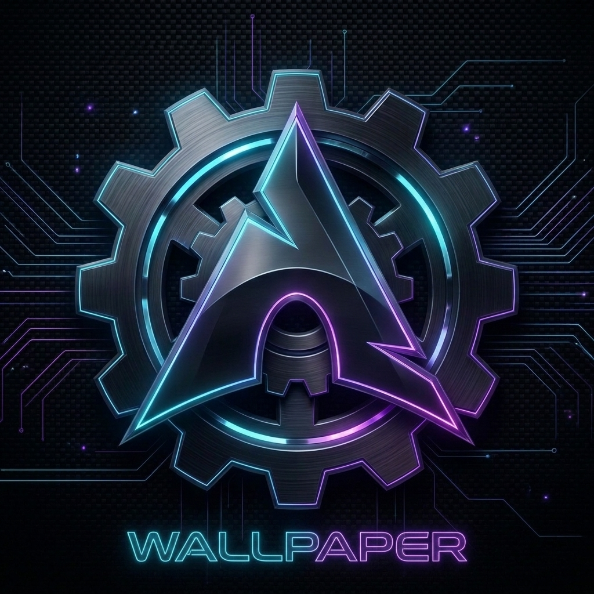

<table>
  <tr>
    <!-- Logotipo integrado (Arch Linux + Engrane) alineado a la izquierda -->
    <td align="center" valign="middle" width="160">
      
    </td>
    <!-- Texto principal e información del proyecto -->
    <td valign="middle">
      <h1>DC_TUX</h1>
      <h2>Wallpaper</h2>
      <p><em>(<a href="https://wallhaven.cc/" target="_blank" rel="noopener noreferrer">Wallhaven</a>).</em></p>
    </td>
  </tr>
</table>

---

## 📂 Contenido Del Repositorio

A continuación se detallan los componentes, respaldos y scripts incluidos en esta configuración:

* 🖼️ **Respaldo de Media:** Colección seleccionada **Wallpapers** en alta definición

---

## 🚀 Uso Rápido

Para clonar y explorar este repositorio en tu sistema local, ejecuta el siguiente comando en tu terminal:

```bash
git clone https://github.com/dc-tux-arch/Wallpaper.git
```
---

<p align="center">Mantén tu sistema actualizado con un simple <code>sudo pacman -Syu</code> 🐧</p>
