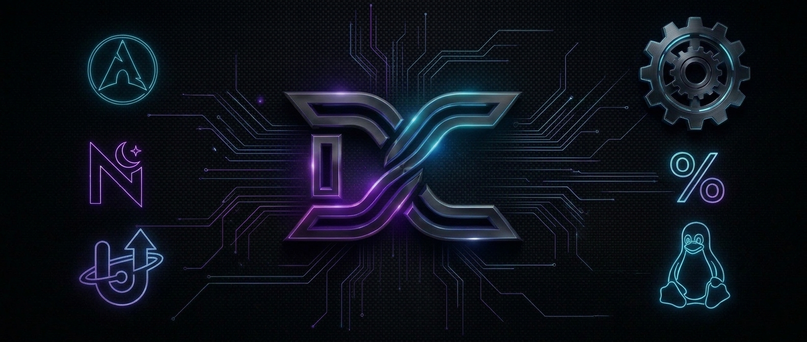
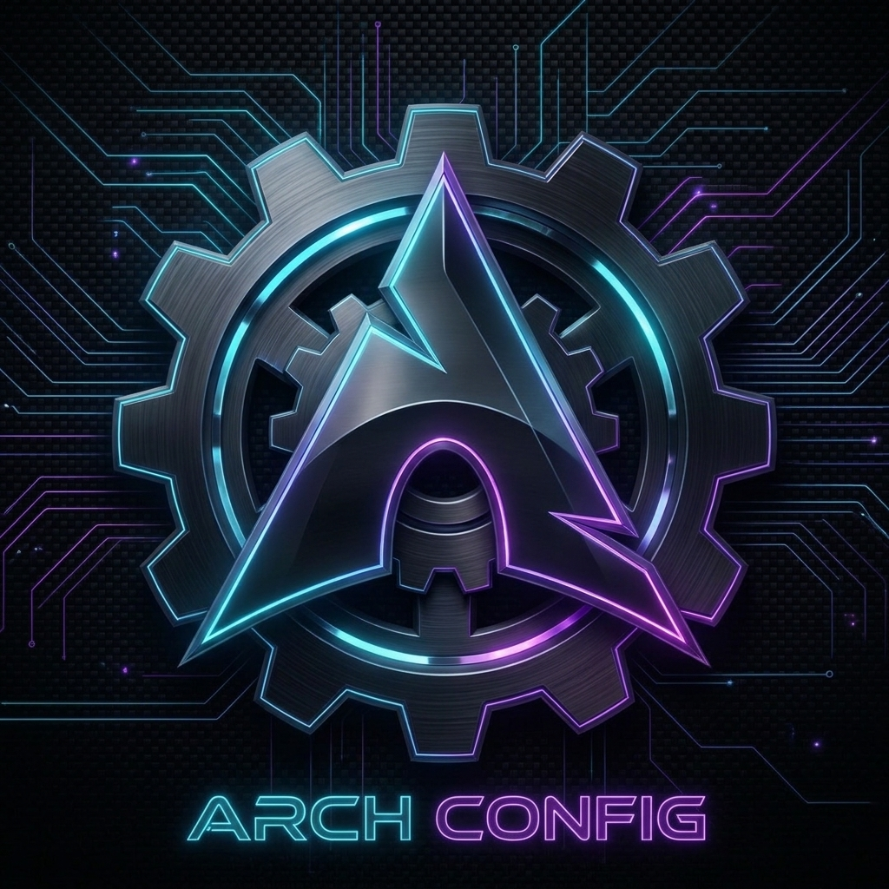

<table>
  <tr>
    <!-- Logotipo integrado (Arch Linux + Engrane) alineado a la izquierda -->
    <td align="center" valign="middle" width="160">
      
    </td>
    <!-- Texto principal e información del proyecto -->
    <td valign="middle">
      <h1># DC_TUX</h1>
      <h2># Configuración Arch Linux</h2>
      <p><em>Entorno de configuración optimizado, minimalista y funcional con estética cyberpunk.</em></p>
    </td>
  </tr>
</table>

---

## 📂 Contenido Del Repositorio

A continuación se detallan los componentes, respaldos y scripts incluidos en esta configuración:

* ⚙️ **Archivos de configuración:** Dotfiles optimizados de *Umbriel* y *noctalia* personalizados para la gestión de ventanas y entorno en ArchLinux.
* 🖼️ **Respaldo de Media:** Colección seleccionada de **Logos** oficiales y **Wallpapers** en alta definición con temática cyberpunk y minimalista.
* 📄 **Documentos:** Notas personales, guías de personalización rápidas y documentación de soporte para el mantenimiento del sistema.
* 🛠️ **Configuraciones del Sistema (Etc):** Ajustes esenciales listos para replicar, incluyendo `nanorc` (sintaxis coloreada) y `pacman.conf` (repositorios y optimizaciones de descarga).
* 🌐 **Mirrors para ArchLinux:** Listado actualizado y ordenado por velocidad y tasa de sincronización de los espejos más estables del sistema.
* 📝 **TXT (Pasos de instalación):** Guía en texto plano con el paso a paso detallado desde cero para realizar una instalación limpia y sin errores del sistema base.

---

## 🚀 Uso Rápido

Para clonar y explorar este repositorio en tu sistema local, ejecuta el siguiente comando en tu terminal:

```bash
https://github.com/dc-tux-arch/arch-dc.git
```

---

<p align="center">Mantén tu sistema actualizado con un simple <code>sudo pacman -Syu</code> 🐧</p>
